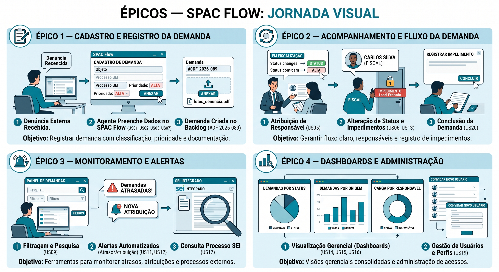
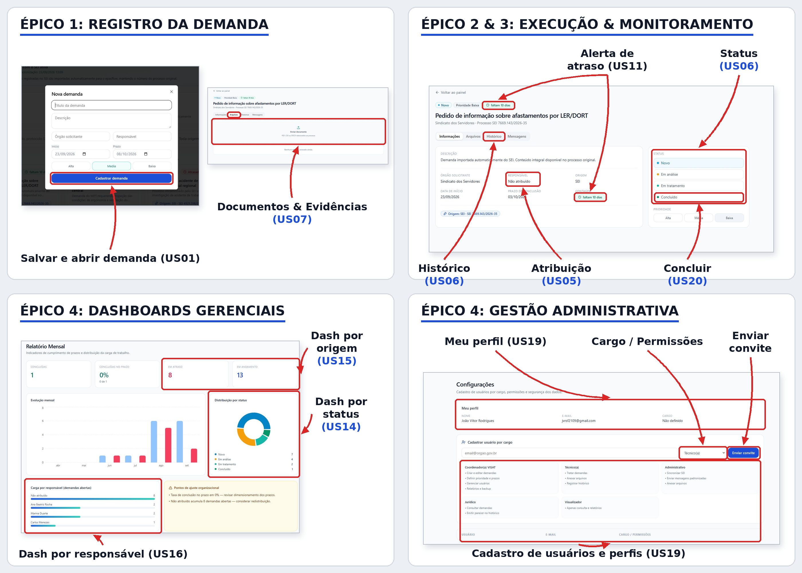
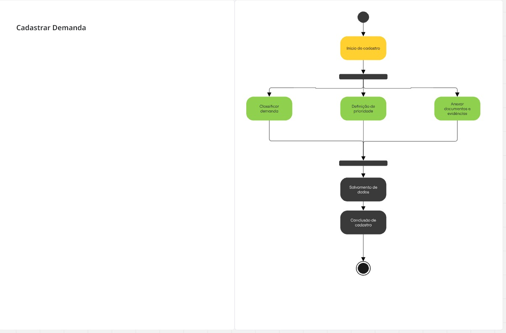
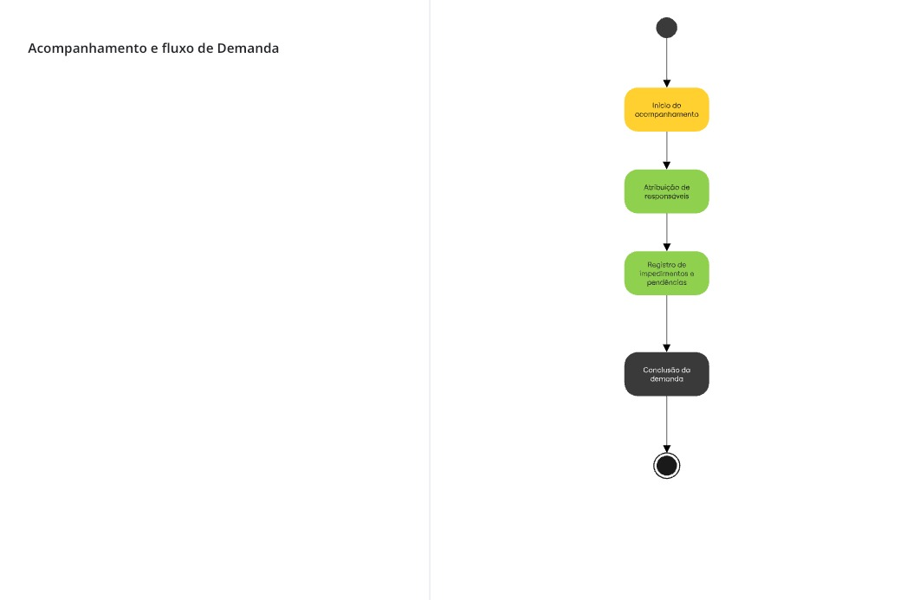
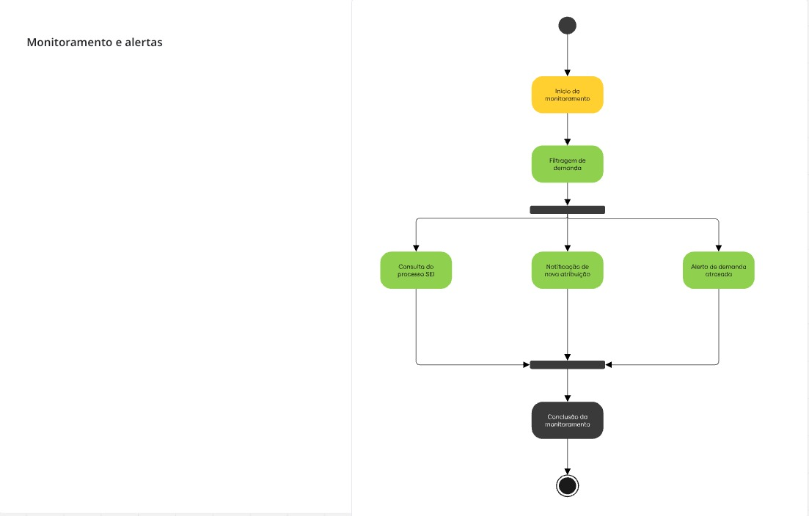
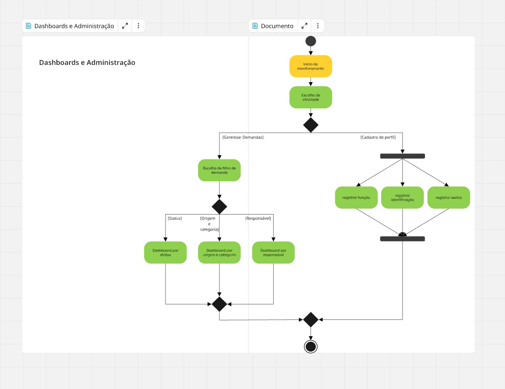
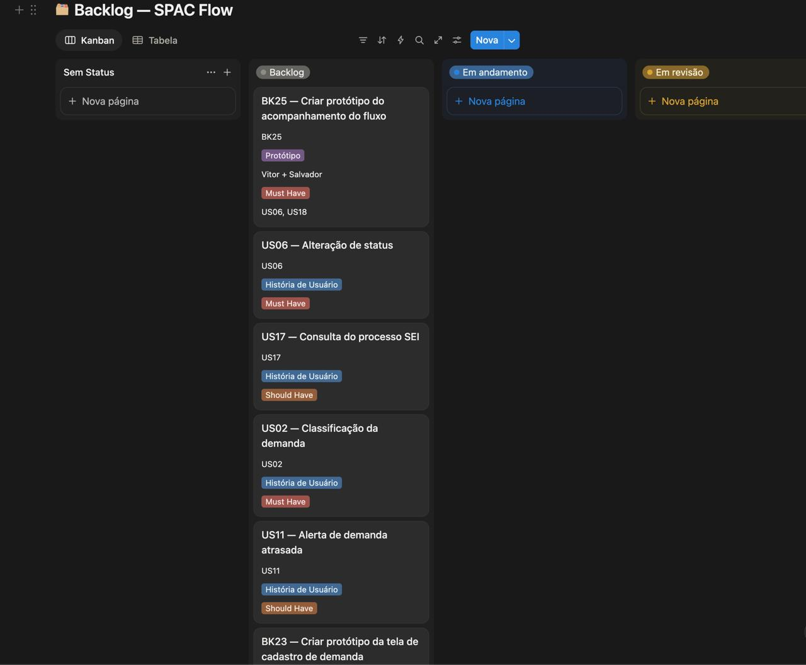
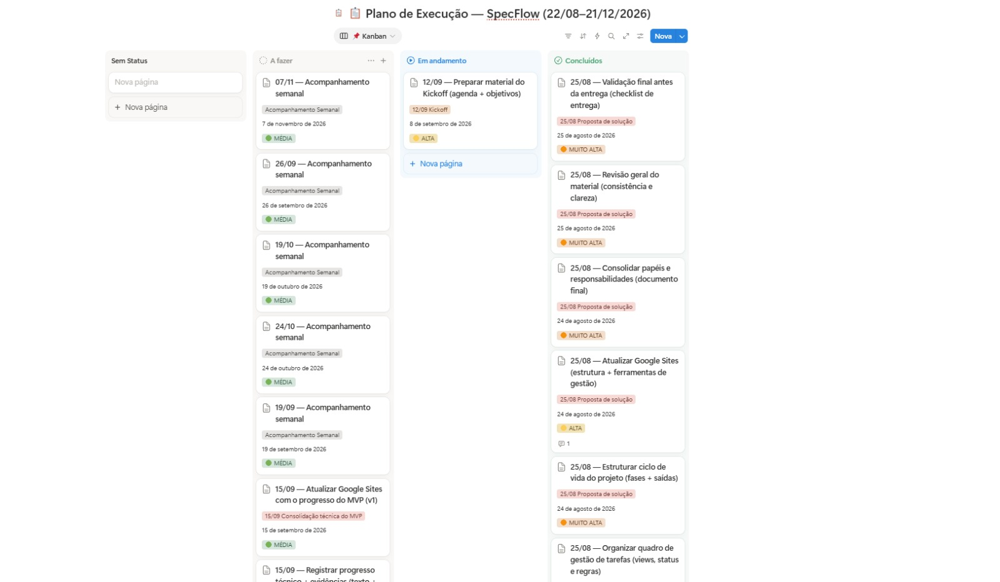

# 🛡️ SpacFlow — VISAT Recife

<div align="center">
  
</div>

<br />

> **Plataforma de Governança, Rastreabilidade e Controle SLA de Fiscalizações em Saúde do Trabalhador**

| **Parâmetro** | **Detalhe do Projeto** |
| :--- | :--- |
| **Instituição Parceira** | Vigilância em Saúde do Trabalhador (VISAT) — Sec. de Saúde do Recife |
| **Demandantes Externos** | MPT (Ministério Público do Trabalho), TRT, Sindicatos e Conselhos |
| **Abordagem** | Design Thinking Coletivo + Framework Scrum |

> 🚀 **Central de Documentação do Projeto:**  
> [](https://sites.google.com/cesar.school/spacflow?usp=sharing)

---

## 🔎 Rastreabilidade

| Artefato | Onde acompanhar |
| :--- | :--- |
| **Board da Sprint (Kanban)** | [Abrir o Board](COLE_AQUI_LINK_DO_BOARD) |
| **Issues (tarefas e bugs)** | [github.com/SPACFlow/SPACFlow/issues](https://github.com/SPACFlow/SPACFlow/issues) |
| **Pull Requests** | [github.com/SPACFlow/SPACFlow/pulls](https://github.com/SPACFlow/SPACFlow/pulls?q=is%3Apr) |
| **Histórico de commits** | [github.com/SPACFlow/SPACFlow/commits](https://github.com/SPACFlow/SPACFlow/commits/main) |
| **Histórias da Sprint 01** | [Seção 9](#9-histórias-de-usuário-da-sprint-01) |
| **Vídeos e testes** | [Seção 13](#13-evidências-e-screencasts) |

---

## 📌 Sumário Navegável
* [1. Visão Geral & Impacto Institucional](#1-visão-geral--impacto-institucional)
* [2. Diagnóstico Operacional: Antes vs. SpacFlow](#2-diagnóstico-operacional-antes-vs-spacflow)
* [3. Prototipação do produto](#3-prototipação-do-produto)
* [4. Mapeamento de Usuário (Persona & Jornada)](#4-mapeamento-de-usuário-persona--jornada)
* [5. Priorização do Escopo (Matriz MoSCoW)](#5-priorização-do-escopo-matriz-moscow)
* [6. Cronograma & Roadmap por Semanas](#6-cronograma--roadmap-por-semanas)
* [7. Gestão Ágil & Governança Operacional](#7-gestão-ágil--governança-operacional)
* [8. Corpo Técnico & Equipe do Projeto](#8-corpo-técnico--equipe-do-projeto)
* [9. Histórias de Usuário da Sprint 01](#9-histórias-de-usuário-da-sprint-01)
* [10. Como Executar e Testar](#10-como-executar-e-testar)
* [11. Relato de Pares (Pair Programming)](#11-relato-de-pares-pair-programming)
* [12. Quadro Kanban de Execução (Board)](#12-quadro-kanban-de-execução-board)
* [13. Evidências e Screencasts](#13-evidências-e-screencasts)

---

## 1. Visão Geral & Impacto Institucional

O **SpacFlow** é uma solução de engenharia de software desenvolvida para sanar a opacidade e a fragmentação no acompanhamento de requisições oficiais na **VISAT Recife**.

A unidade opera sob constante demanda por pareceres técnicos e inspeções de campo. Sem um sistema centralizado, os processos tramitam via planilhas e e-mails isolados, gerando riscos de descumprimento de prazos judiciais e falta de visibilidade sobre a sobrecarga das equipes técnicas. O SpacFlow fornece trilha de auditoria e controle em tempo real do ciclo de vida das requisições.

---

## 2. Diagnóstico Operacional: Antes vs. SpacFlow

| Indicador / Processo | Gestão Tradicional (Planilhas / E-mails) | Solução SpacFlow |
| :--- | :--- | :--- |
| **Gestão de SLA Legal** | Controle manual de datas em células com alto risco de atraso em respostas ao MPT/TRT | Painel com contagem regressiva e alertas visuais automáticos de vencimento |
| **Rastreabilidade** | Histórico disperso entre caixas de entrada e pastas de arquivos locais | Linha do tempo imutável com registro de todas as ações por fiscal |
| **Carga de Trabalho** | Ausência de indicadores sobre a distribuição de solicitações na equipe | Visualização Kanban por inspetor e relatórios gerenciais de capacidade |
| **Documentação** | Risco de perda de laudos, anexos e fotos colhidas em vistorias de campo | Repositório centralizado anexado à requisição (PDF, CSV, DOCX) |

---

## 3. Prototipação do produto

Para manter a transparência do processo de design e evitar a poluição visual na rolagem da página, as evidências de prototipação estão disponíveis nos painéis expansíveis abaixo:

<details>
  <summary><b>🎥 Clique para expandir o Screencast</b></summary>
  <br />
  <p><b>🎬 Screencast — Demonstração do Protótipo</b><br/>
  Assista à gravação demonstrando o fluxo de uso do sistema, dividida pelos épicos mapeados.</p>
  <div align="center">

  **1º Épico** — `0:00 – 2:03`
  <br />
  [](https://youtu.be/s-iLAhLnd8c)

  <br /><br />

  **2º Épico** — `2:04 – 2:51`
  <br />
  [](https://youtu.be/s-iLAhLnd8c?t=124)

  <br /><br />

  **3º Épico** — `2:52 – 4:42`
  <br />
  [](https://youtu.be/s-iLAhLnd8c?t=172)

  <br /><br />

  **4º Épico** — `4:43 – 6:16`
  <br />
  [](https://youtu.be/s-iLAhLnd8c?t=283)

  </div>
</details>

<br />

<details>
  <summary><b>🎨 Clique para expandir o Storyboard e os Wireframes</b></summary>
  <br />
  <p><i>Da jornada desenhada a mão às telas finais do sistema, com cada artefato rastreado até as histórias de usuário que atende.</i></p>

  <p><b>📌 Storyboard — Jornada Visual dos Épicos</b><br/>
  Representa, em quadros ilustrados, a jornada completa do usuário em cada um dos 4 épicos do SpacFlow: cadastro e registro da demanda, acompanhamento e fluxo da demanda, monitoramento e alertas, e dashboards/administração — mostrando passo a passo as ações do agente, do fiscal e do gestor dentro do sistema.</p>
  <div align="center">
    
  </div>

  <br />

  <p><b>🖥️ Wireframes — Telas de Alta Fidelidade</b><br/>
  Telas principais do sistema, organizadas pelos mesmos 4 épicos do storyboard. As setas indicam qual história de usuário cada elemento atende: registro de demanda e anexos (US01, US07); execução e monitoramento, com atribuição, status, histórico, alerta de atraso e conclusão (US05, US06, US11, US20); dashboards gerenciais por status, origem e responsável (US14, US15, US16); e gestão administrativa de perfis e usuários (US19).</p>
  <div align="center">
    
  </div>
</details>

<br />

<details>
  <summary><b>🔗 Clique para expandir os Diagramas de Atividade</b></summary>
  <br />
  <p><i>Diagramas de atividade modelando o comportamento operacional e as decisões dos fluxos mapeados.</i></p>

  <p><b>1. Cadastrar Demanda</b><br/>
  Fluxo de entrada da solicitação, ramificando em paralelo a classificação da demanda, definição de prioridade e anexação de documentos e evidências.</p>
  <div align="center">
    
  </div>

  <br />

  <p><b>2. Acompanhamento e Fluxo de Demanda</b><br/>
  Sequência do ciclo de vida da solicitação: início do acompanhamento, atribuição de responsáveis, registro de impedimentos ou pendências e conclusão da demanda.</p>
  <div align="center">
    
  </div>

  <br />

  <p><b>3. Monitoramento e Alertas</b><br/>
  Processo de controle e rastreabilidade: filtragem de demandas, consulta ao processo SEI, notificação de nova atribuição e emissão de alertas para demandas atrasadas.</p>
  <div align="center">
    
  </div>

  <br />

  <p><b>4. Dashboards e Administração</b><br/>
  Fluxo de gestão operacional dividido entre a visualização de métricas (gerenciamento por status, origem/categoria ou responsável técnico) e a governança de acessos através do cadastro de perfis (função, identificação e credenciais).</p>
  <div align="center">
    
  </div>
</details>

---

## 4. Mapeamento de Usuário (Persona & Jornada)

### 👤 Persona Representativa
* **Ana Beatriz Souza (34 anos)** — *Técnica de Vigilância Sanitária*.
* **Contexto:** Necessita responder a órgãos externos dentro do prazo legal enquanto realiza fiscalizações externas.
* **Principal Dor:** Desperdiçar tempo reorganizando prioridades em planilhas informais e cobrando retornos por telefone.

### 🛣️ Jornada do Processo (Mariana Santos — Inspetora)
1. **Chegada:** Notificação de nova solicitação externa sem contexto consolidado.
2. **Triagem:** Análise manual e verificação de antecedentes em pastas físicas/digitais.
3. **Atribuição:** Encaminhamento para a agenda do inspetor responsável.
4. **Campo & Laudo:** Realização da visita, coleta de evidências e redação técnica.
5. **Encerramento:** Envio formal do parecer ao órgão solicitante e arquivamento.

---

## 5. Priorização do Escopo (Matriz MoSCoW)

| Categoria | Funcionalidades Mapeadas no SpacFlow |
| :--- | :--- |
| **Must Have** *(Indispensável)* | Centralização de documentos, filtros de busca por processo, controle de SLA/prazos e perfis por função. |
| **Should Have** *(Importante)* | Histórico de tramitação por demanda, modelos de resposta padrão e rotina de cópias de segurança. |
| **Could Have** *(Desejável)* | Painel com indicadores gerenciais avançados e alertas de sobrecarga de trabalho. |
| **Won't Have** *(Fora do Escopo 1.0)* | Integração nativa automatizada com sistemas legados de órgãos externos. |

---

## 6. Cronograma & Roadmap por Semanas

O projeto é executado através de uma abordagem incremental dividida em 7 semanas de desenvolvimento:

| Semana / Etapa | Foco Principal | Entregas Esperadas | Status |
| :---: | :--- | :--- | :---: |
| **Semana 01**<br>*(Imersão)* | Entendimento do problema, pesquisa inicial e organização do grupo | Entregáveis para apresentação inicial | `Concluído` |
| **Semana 02**<br>*(Validação)* | Contato com a VISAT, validação de hipóteses e entendimento do processo | Hipóteses validadas e dúvidas respondidas | `Concluído` |
| **Semana 03**<br>*(Requisitos)* | Levantamento de requisitos, histórias de usuário, fluxos e priorização | Backlog priorizado e especificação inicial | `Concluído` |
| **Semana 04**<br>*(UX / UI)* | Construção de wireframes, protótipos e fluxo de navegação | Protótipo validado | `Concluído` |
| **Semana 05**<br>*(Desenvolvimento)* | Banco de dados (PostgreSQL), backend, frontend e integração | Incrementos funcionais do sistema | `Em andamento` |
| **Semana 06**<br>*(Testes)* | Testes de software, correções de bugs e validações | Versão estável do sistema | `Pendente` |
| **Semana 07**<br>*(Entrega Final)* | Consolidação do sistema, documentação e apresentação de resultados | Entrega final do projeto | `Pendente` |

> *Nota: O cronograma é flexível e pode sofrer ajustes conforme orientações do orientador e alinhamentos das entregas semanais.*

---

## 7. Gestão Ágil & Governança Operacional

Para manter a transparência das etapas e evitar a poluição visual na rolagem da página, os artefatos de acompanhamento da equipe estão disponíveis nos painéis expansíveis abaixo:

<details>
  <summary><b>📊 Clique para expandir a Central de Backlog Refinado</b></summary>
  <br />
  <p><i>Mapeamento de Épicos, Histórias de Usuário, níveis de prioridade e rastreamento de entregas por integrante.</i></p>
  <div align="center">
    
  </div>
</details>

<br />

<details>
  <summary><b>🎯 Clique para expandir o Quadro Kanban de Execução (Board)</b></summary>
  <br />
  <p><i>Fluxo de tarefas ativas divididas em tempo real entre Ideação, Design, Desenvolvimento, Code Review e Homologação.</i></p>
  <div align="center">
    
  </div>
</details>

---

## 8. Corpo Técnico & Equipe do Projeto

| Avatar | Integrante | Função no Projeto | E-mail | Perfil |
| :---: | :--- | :--- | :--- | :---: |
|  | **Antonio Leite Sandes** | Gestor de Projeto | `als5@cesar.school` | [](https://github.com/als5-rgb) |
|  | **Arthur Cabral Tietzman** | Desenvolvedor | `act2@cesar.school` | [](https://github.com/ArthurCabralTietzmann) |
|  | **Gabriel Salvador P. da Silva Santos** | Execução e Testes | `gspss@cesar.school` | [](https://github.com/Gabriel-Salvador-1) |
|  | **João Vitor Rodrigues** | Ideação e Pesquisa | `jvrsf@cesar.school` | [](https://github.com/Rodrigues2109) |
|  | **Matheus Figueiredo** | Gestor do Produto (PO) | `mffm@cesar.school` | [](https://github.com/mffm11) |
|  | **Sérgio Bione de Almeida Bastos** | Desenvolvedor | `sbab@cesar.school` | [](https://github.com/S-Bione) |
|  | **Vitor Emmanuel Fernandes** | Execução e Testes | `velfg@cesar.school` | [](https://github.com/Vitor-Emmanuel) |

---

## 9. Histórias de Usuário da Sprint 01

Cada história tem um arquivo próprio em `src/funcionalidades/`, e o menu em `src/main.js` chama todas elas.

### Prioridade alta — funcionalidades iniciais

1. **Cadastrar demanda ([`cadastrarDemanda.js`](src/funcionalidades/cadastrarDemanda.js)):** Como servidor da VISAT, quero cadastrar uma demanda, para registrar as solicitações recebidas pelo setor.
2. **Consultar demandas ([`consultarDemandas.js`](src/funcionalidades/consultarDemandas.js)):** Como integrante da VISAT, quero visualizar as demandas cadastradas, para acompanhar o andamento das solicitações.
3. **Atualizar o status da demanda ([`atualizarStatus.js`](src/funcionalidades/atualizarStatus.js)):** Como responsável por uma demanda, quero atualizar sua situação, para manter a equipe informada sobre o progresso.
4. **Definir prioridade ([`definirPrioridade.js`](src/funcionalidades/definirPrioridade.js)):** Como gestor, quero definir a prioridade de uma demanda, para identificar quais solicitações devem ser atendidas primeiro.

### Prioridade média — funcionalidades de acompanhamento

5. **Atribuir responsável ([`atribuirResponsavel.js`](src/funcionalidades/atribuirResponsavel.js)):** Como gestor, quero indicar um responsável pela demanda, para organizar a execução das atividades da equipe.

### Resumo por história

| # | História | Opção no menu | Dupla | Regras principais |
| :---: | :--- | :---: | :--- | :--- |
| 1 | Cadastrar demanda | 1 | Dupla 1 | Título e solicitante obrigatórios; toda demanda nasce como *Pendente* |
| 2 | Consultar demandas | 2 | Dupla 1 | Mostra todas as demandas, com filtro por status |
| 3 | Atualizar status | 3 | Dupla 2 | Só o responsável pela demanda atualiza; demanda concluída ou cancelada não muda mais |
| 4 | Definir prioridade | 4 | Dupla 2 | Baixa, Média, Alta ou Urgente; mostra a fila da mais urgente para a menos urgente |
| 5 | Atribuir responsável | 5 | Dupla 3 | Nome obrigatório (até 100 caracteres); mostra quem saiu ao trocar o responsável |

---

## 10. Como Executar e Testar

Requisito: [Node.js](https://nodejs.org/) 20 ou mais recente. O projeto não tem dependências externas, então não é preciso rodar `npm install`.

```bash
npm start   # abre o menu do SpacFlow no terminal
npm test    # roda os testes automatizados (testes.js)
```

Os testes usam apenas os módulos nativos `node:test` e `node:assert`. Eles cobrem as 5 histórias, com casos de sucesso e de erro, os menus de cada opção com entradas simuladas e a integração do `main.js` com os arquivos de cada dupla.

---

## 11. Relato de Pares (Pair Programming)

### Como o trabalho foi dividido

Para evitar conflitos no Git, cada dupla trabalhou apenas nos seus arquivos e em uma branch própria. O `main.js` é o único arquivo compartilhado: ele importa a função de menu de cada história, e a Dupla 3 ficou responsável por ele. A entrega na `main` é feita por Pull Request.

| Dupla | Integrantes | Histórias | Arquivos |
| :--- | :--- | :--- | :--- |
| **Dupla 1** | Matheus e Antonio (Thony) | 1 e 2 | `cadastrarDemanda.js`, `consultarDemandas.js` |
| **Dupla 2** | Arthur e Sérgio | 3 e 4 | `atualizarStatus.js`, `definirPrioridade.js` |
| **Dupla 3** | João e Vitor (Vitinho) | 5 + integração | `atribuirResponsavel.js`, `main.js` |

### Setup da arquitetura

Na divisão da sprint, o setup ficou com João e Thony. A estrutura foi enviada ao repositório no commit `1ba038f` (20/10), pela conta do Matheus, já com a primeira versão das histórias 1 e 2:

- `package.json` com ES Modules e o comando `npm start`;
- `src/main.js`: o menu que chama as 5 funcionalidades;
- `src/models/demanda.js`: o formato de uma demanda e as listas de status e prioridades;
- `src/repositories/demandaRepository.js`: o armazenamento das demandas em memória (gerar ID, adicionar, listar e buscar por ID);
- `src/funcionalidades/`: um arquivo por história.

O padrão combinado foi que cada arquivo tenha duas partes: uma função com a regra e as validações (por exemplo, `atribuirResponsavel`) e uma função de menu que conversa com o usuário (por exemplo, `executarAtribuirResponsavel`). O `main.js` usa só a função de menu. A função de regra pode ser testada sozinha.

### O que cada dupla implementou

**Dupla 1 — Matheus e Thony (histórias 1 e 2)**
- `cadastrarDemanda.js`: valida título e solicitante, remove espaços extras, gera o ID e cria a demanda como *Pendente*, sem prioridade e sem responsável.
- `consultarDemandas.js`: devolve uma cópia da lista de demandas, com filtro opcional por status, e mostra uma tabela com `-` nos campos vazios.
- Na branch `grupo1`, houve uma evolução do cadastro com origem, categoria e prazo (commit `b0a0897`, Arthur), que ainda não foi integrada na `main`.

**Dupla 2 — Arthur e Sérgio (histórias 3 e 4)**
- `definirPrioridade.js` (Sérgio, `6a3e2f9`): define ou troca a prioridade aceitando texto sem acento, recusa prioridade inválida, repetida ou de demanda encerrada, e ordena a fila por prioridade, depois pela data de cadastro e por fim pelo ID.
- `atualizarStatus.js` (Arthur, `43f676d`): primeira versão com a lista de status válidos e a validação de permissão. Essa versão ainda não tinha a função de menu que o `main.js` importa, então a Dupla 3 completou a integração (ver abaixo).

**Dupla 3 — João e Vitinho (história 5 e integração)**
- `atribuirResponsavel.js` (João, `3dcf127`): lista só as demandas em aberto, valida ID, nome vazio, nome com mais de 100 caracteres e responsável repetido, e informa quem saiu quando o responsável é trocado.
- `main.js` (João, `3dcf127`; Vitinho, `98e8501` na `develop`): menu que importa as 5 funções, aceita a opção com espaços, explica opção inválida e mostra os erros de cada funcionalidade sem fechar o sistema.
- Documentação: README e imagens levados da `develop` para a `main` (`a9a4c1e`); seções de quadro e demonstração com vídeo de teste (Vitinho, `e61959f`).
- Correção da integração do `atualizarStatus.js` (João, Entrega 3): o arquivo passou a exportar `executarAtualizarStatus`, sem a qual o sistema não abria; o novo status passou a ser salvo na demanda; e foi aplicada a regra da história 3, em que só o responsável pela demanda atualiza o status. A lista de status válidos e as validações da primeira versão foram mantidas.
- `testes.js` (João, Entrega 3): testes automatizados das 5 histórias e da integração (`npm test`).

### Interação via Pull Requests

| Etapa | Branch | O que aconteceu |
| :--- | :--- | :--- |
| [PR #1](https://github.com/SPACFlow/SPACFlow/pull/1) | `grupo2` → `main` | Aberto pela Dupla 3 com a história 5 e o `main.js`; Sérgio (Dupla 2) incluiu o `definirPrioridade.js` na mesma branch, revisou e aceitou em 21/10 |
| Merge `7d8adf8` | `grupo2` → `main` | Arthur levou para a `main` a primeira versão do `atualizarStatus.js` em 21/10 |
| PR da Entrega 3 | `entrega3-ajustes` → `main` | Dupla 3 corrige a integração do `atualizarStatus.js` e adiciona os testes automatizados e esta documentação |
| [PR #2](https://github.com/SPACFlow/SPACFlow/pull/2) | `develop` → `main` | Aberto por Vitinho com ajustes de integração e o vídeo de teste; em resolução de conflito |

A partir desta entrega, toda mudança na `main` entra por Pull Request ligado a uma Issue e revisado por alguém de outra dupla.

---

## 12. Quadro Kanban de Execução (Board)

O board atualizado fica no link da seção [Rastreabilidade](#-rastreabilidade). A imagem abaixo registra o estado do quadro durante a sprint.

<details>
<summary>🎯 Clique para expandir o Quadro Kanban de Execução (Board)</summary>

<br>
<p align="center">
  
</p>

</details>

---

## 13. Evidências e Screencasts

| Evidência | O que mostra | Link |
| :--- | :--- | :---: |
| **Vídeo das novas histórias** | O menu funcionando de ponta a ponta: cadastrar, consultar, definir prioridade, atribuir responsável e atualizar status | [](COLE_AQUI_LINK_VIDEO_HISTORIAS) |
| **Screencast dos testes automatizados** | O comando `npm test` rodando os testes das 5 histórias e da integração | [](COLE_AQUI_LINK_VIDEO_TESTES) |
